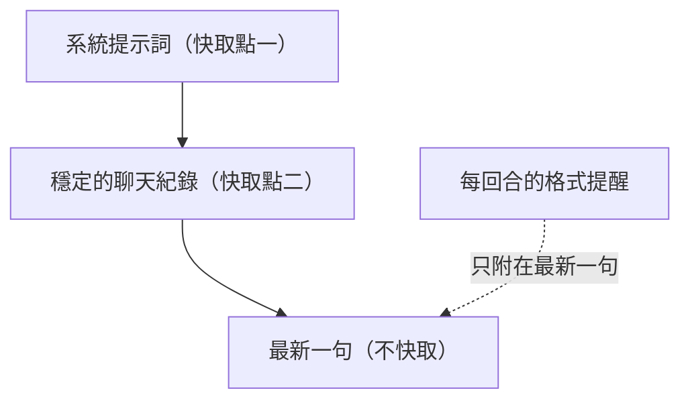

# 0002 快取：不變的放前面，讓 Claude 記住

- 狀態：已採用

## 背景
每句聊天都要送「人設、教學規則、整段聊天紀錄」給 Claude。人設和規則每次都一樣，卻每次全價計算，聊越久越貴越慢。格式規則（欄位格式、日文標記、讀音）又一條都不能少。

實測（Claude 5 分鐘提示快取，取自作者實際使用的紀錄）：整體命中 46%（含開場寫入、速查與小提醒），連續聊天時每句約 70%；總花費省 18.8%。系統提示詞加聊天紀錄只有約兩千 token，前綴小，每次重新寫入快取的成本占比就高，所以命中率不會像前綴有數萬 token 的 agent 那麼高。

## 考慮過的選項
**A. 不快取，每次全送**
- 優點：最簡單。
- 缺點：每句都付全價；越聊越貴、越慢。

**B. 會變的內容也放進系統提示詞**（例如現在時間）
- 優點：模型一定看得到。
- 缺點：內容每次不同，快取永遠對不上。

**C. 不變的放前面，會變的放最後（採用）**
- 優點：前段整段重用，每句只算新的一句；規則一條不少。
- 缺點：任何一個字變動都會讓快取失效。

## 決定
系統提示詞與「最新一句之前的穩定紀錄」各設一個快取點。每回合會變的格式提醒包在提醒標記裡，只附在最新一句、不存回紀錄；時間情境寫在使用者那句的開頭，不放進系統提示詞。

## 做法

- 前段（人設、規則、穩定紀錄）整段重用，每句只重新計算新的一句。
- 超過 39 行，或閒置超過 1 小時，就重新開始，讓前段保持不變。

## 取捨
- 寫入快取比一般輸入貴，只有連續聊天才划算；因此閒置 1 小時後只送最近 5 則。
- 模擬顯示，間隔超過 5 分鐘再聊會多花約 20.5%。
- 舊的小提醒不送回模型，省 token，也避免越聊越偏。
- 換人設時，聊天從新的一行重新開始，下一句要重新寫入快取；見 [0008](0008-persona-and-picture.md)。

## 何時重新評估
- 聊天間隔常超過 5 分鐘 → 考慮較長的快取時間。
- 改了 39 行上限或 1 小時閒置時間 → 重新量命中率。
- 換成沒有提示快取的模型或供應商 → 這套設計要重做。
