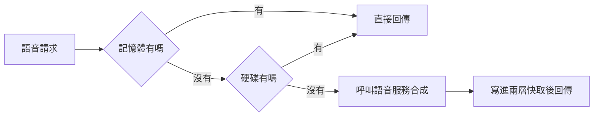

# 0006 語音快取：同一句不付兩次

- 狀態：已採用

## 背景
雲端語音按字數收費；重播、試聽、拉語速滑桿都不該再花錢。快取也不能無限長大。實測（本機 VOICEVOX，n=10）：合成中位數 3,689 ms，快取命中中位數 18.8 ms，約快 196 倍。語音快取命中率：VOICEVOX 70.2%，全部引擎（含 Google）61.8%。

## 考慮過的選項
**A. 每次都呼叫 API**
- 優點：最簡單。
- 缺點：重播也付錢，比較慢。

**B. 存在手機瀏覽器的儲存空間**
- 優點：不經過伺服器。
- 缺點：空間有限，換裝置就沒了。

**C. 伺服器兩層快取（採用）**
- 優點：所有裝置共用，重開伺服器還在。
- 缺點：要管容量與寫入安全。

## 決定
先查記憶體快取（最多 200 筆），再查硬碟快取（上限 200 MB，最久沒用的先刪），都沒有才呼叫語音服務。快取鍵由引擎、聲音、語速、音高與文字組成。手機一律請求 1 倍速、原音高，語速與音高在手機端用 SoundTouch 調整，所以拉滑桿也命中同一份快取。

## 做法

- 同一句同時到來的請求只合成一次，避免重複付費。
- 硬碟檔名是快取鍵的雜湊值，看不出句子內容；寫入先寫暫存檔再改名，避免半截檔。

## 取捨
- 快取放在開發伺服器所在的電腦，最多多占 200 MB。
- 在手機調速會略降音質。
- 改了引擎或聲音，舊的快取就用不到。

## 何時重新評估
- 常用句子超過 200 MB → 調高上限。
- 多人使用 → 改放雲端儲存。
- 雲端語音降價或免費 → 快取的價值變小。
