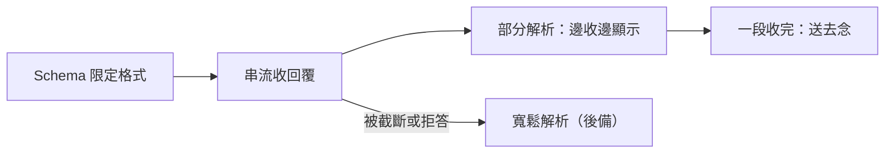

# 0007 Structured Outputs：格式交給 API 保證

- 狀態：已採用

## 背景
速查、改寫小提醒、判斷練習與聊天，程式都要讀模型的回覆。以前只在提示詞裡要求格式，程式再用比對文字的方式找出結構。模型偶爾多寫一句、少一個欄位，或把等級寫成「N3 左右」，就解析失敗。模擬顯示舊的嚴格解析只有約 60% 成功（模擬，失誤比例為自訂）。

## 考慮過的選項
**A. 只靠提示詞與寬鬆解析**
- 優點：不必改 API 請求。
- 缺點：格式靠模型自律，失敗只能顯示原文。

**B. 限定格式，整段收完才解析**
- 優點：格式保證。
- 缺點：要等整段收完才顯示。

**C. 限定格式加部分解析，邊收邊顯示（採用）**
- 優點：格式保證，也能邊收邊顯示。
- 缺點：前端解析較複雜；被截斷時只保留已完成的部分。

## 決定
程式要讀的回覆都用 JSON Schema 限制格式，包含速查、小提醒改寫、判斷練習與聊天。舊的寬鬆解析保留為後備。

## 做法

- 只接受清單內的語氣值，其他一律丟棄。
- 被截斷時只保留已完成的部分，整段格式問題交給後備處理。

## 取捨
- Schema 會讓請求多一段格式說明，輸入 token 稍多。
- Schema 只保證結構，不保證內容（讀音與語言仍靠 [0004](0004-server-guards.md)）。
- 被截斷或拒答時不保證格式，因此保留舊解析當後備。
- 改了 Schema 結構，聊天的提示快取會失效（見 [0002](0002-prompt-cache.md)）。

## 何時重新評估
- 串流經常中斷 → 檢視部分解析的後備，必要時改回標記式格式。
- 接上本機模型 → 它不認得 Schema，靠後備解析。
