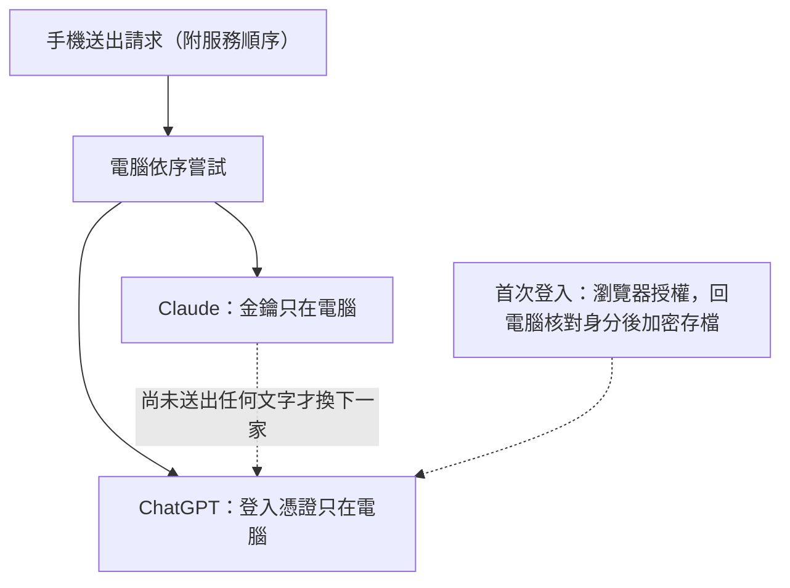

# 0009 AI 路由與登入：Claude 與 ChatGPT 依序備援

- 狀態：已採用

## 背景
聊天與背景工作原本只能用 Anthropic API 金鑰。要能改由已登入的 ChatGPT 帳號回答，又不能讓金鑰或 token 進到手機，也不能因為一家服務掛掉整個功能停擺。兩家的請求格式不同：Anthropic Messages 與 OpenAI Responses。

## 考慮過的選項
**A. 每個功能各自分支**（聊天、判斷、小提醒、速查各自判斷用哪一家）
- 優點：沒有抽象層，直接好懂。
- 缺點：四個功能各寫一次分支與錯誤判斷，很容易彼此不一致。

**B. 統一的供應商介面，請求以 Anthropic 格式為準，由各家轉接（採用）**
- 優點：路由、防護、串流與計費只寫一次；加一家服務只加一個轉接器。
- 缺點：OpenAI 端要做格式轉換；Anthropic 專屬的快取點對 OpenAI 無效。

**C. 外接代理（例如 LiteLLM）**
- 優點：不必自己寫轉換。
- 缺點：多一個常駐程序與依賴；OAuth 登入與方案額度仍要自己處理。

## 決定
每個 AI 請求都帶一份服務順序（1 到 2 家、不重複，預設只有 Claude）與可選的 ChatGPT 模型，伺服器依序嘗試。ChatGPT 以 OpenAI 官方 OAuth（PKCE）登入；金鑰與 token 只存在這台電腦。登入與登出只能在電腦上按，手機只看登入狀態，並可以選 ChatGPT 的模型。

## 做法

- 手機不碰金鑰或 token；格式轉換由電腦完成，只送對方認得的內容。
- 登入憑證加密存在這台電腦，加密金鑰交給 Windows 的使用者保護機制保管。

## 取捨
- 格式轉換是有損的：OpenAI 端只收文字，快取點與 Anthropic 專屬的測試功能不轉送。
- ChatGPT 的用量不計入每日上限（MUGI_DAILY_USD），那個上限只管 Claude。
- 串流一旦送出文字就不能換服務，避免兩家的文字接在一起。
- 手機不能登入或登出 ChatGPT：換帳號或重新授權，要走到電腦前操作。代價是遠端不能獨自完成登入。
- 憑證檔無法解開時伺服器停止、不覆寫，避免把登入資料弄丟。非 Windows 沒有這層保護，憑證檔以僅本人可讀寫的權限存成純 JSON。

## 何時重新評估
- 加入第三家服務 → 擴充服務清單與數量上限，新增一個轉接器。
- OpenAI 改版回應格式或登入端點 → 重新測試格式轉換與登入時的設定探索檢查。
- Anthropic 的自動換模型測試功能行為改變 → 重看聊天請求的測試功能設定與換模型設定。
